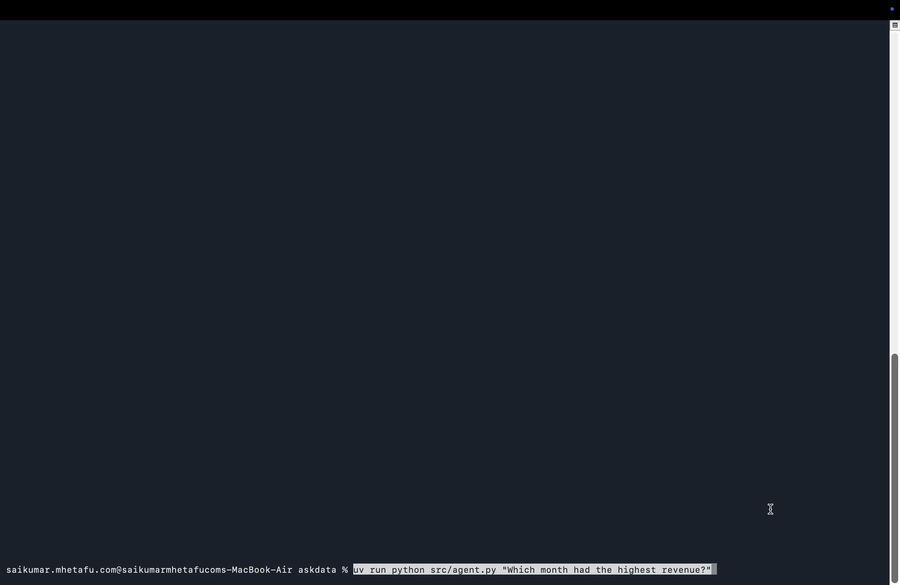

# AskData

**Ask business questions in plain English; get answers from an e-commerce database.**
A text-to-SQL agent with a systematic evaluation, built as an AI Product Manager portfolio project.

## Headline result

A schema guide documenting 6 business-data traps raised execution accuracy from **74% to 98%** on a 50-question golden set.

| | Guide OFF | Guide ON |
|---|---|---|
| **Execution accuracy** | **74%** | **98%** |
| Joins (20 questions) | 13 | 20 |
| Hard (10 questions) | 5 | 10 |
| Avg tokens per question | 880 | 2,502 |
| Avg latency | 1.27s | 1.96s |

The entire gain came from questions that touch a documented trap (24/37 -> 36/37); questions with no trap scored 13/13 either way. Details in [docs/error_analysis.md](docs/error_analysis.md).

### Medium level: does it generalise?

| Configuration (3 runs each) | Golden set | Held-out (new questions) |
|---|---|---|
| Schema guide | 92.7% | 93.3% |
| Schema guide + semantic layer | 96.7% | 93.0% |

The guide generalises to questions written after it (60% -> 93%). The semantic layer's accuracy gain is within run-to-run variation, but it makes metric definitions consistent, at about 73% more tokens. Details in [docs/medium_results.md](docs/medium_results.md).

### Hard level: safe, usable from Claude, measured

- **Guardrails:** only a single read-only SELECT can ever run, with no file access, enforced in code (20 automated tests). Red-team prompts to delete data or read a private file were refused.
- **MCP server:** Claude (desktop app) can use AskData through four tools: `ask`, `run_query`, `list_metrics`, `describe_metric`. Verified through the live connection.
- **Tracing and cost:** every question is logged. About **$1.67 per 1,000 questions** and **~1 second** typical response time.

Details in [docs/hard_results.md](docs/hard_results.md).

## How it works

    Question -> Gemini (schema + schema guide) -> SQL -> DuckDB (read-only) -> Answer + assumptions

1. The agent reads the database schema automatically and, optionally, the schema guide.
2. Gemini returns JSON: the SQL, the assumptions it made, or a clarifying question if the request is too vague.
3. The SQL runs on a **read-only** connection, so the agent can never change data.

## What I did as the PM

- **Found the data traps** that make AI answers wrong, and documented them with evidence and a rule for each: [schema guide](docs/schema_guide.md)
- **Built a 50-question golden set** with verified answers: 15 simple, 20 join, 10 hard, 5 ambiguous ([evals/golden.jsonl](evals/golden.jsonl))
- **Measured the agent with and without the guide**, then read every failure by hand
- **Found and fixed 3 bugs in my own evaluation**; the improvement stayed at 22-24 points across all versions
- **Made and logged the business decisions** behind the metrics: [decision log](docs/decision_log.md)
- **Wrote the PRD**: problem, users, metrics, guardrails and roadmap: [PRD](docs/PRD.md)

## Business insights found along the way

- A late delivery drops the average review from **4.29 to 2.57 stars**. Delivery speed drives satisfaction more than anything else in this data.
- The highest-revenue day was **Black Friday, 24 Nov 2017**, about 5x a normal day.

## Run it yourself

1. Install [uv](https://docs.astral.sh/uv/), then run `uv sync`.
2. Download the [Olist dataset from Kaggle](https://www.kaggle.com/datasets/olistbr/brazilian-ecommerce) and unzip the CSVs into `data/`. (The dataset has a non-commercial licence, so it is linked here rather than included.)
3. Copy `.env.example` to `.env` and add your Gemini API key.
4. Load the data: `uv run python src/load_data.py`
5. Ask a question: `uv run python src/agent.py "Which state has the most customers?"`
6. Run the evaluation: `uv run python evals/run_eval.py` (add `--no-guide` for the baseline)
7. Use it from the Claude desktop app: add an `askdata` entry to `claude_desktop_config.json` that runs `uv --directory <path-to-askdata> run python src/mcp_server.py`, then restart Claude.

## Project structure

| Path | What it is |
|---|---|
| `src/agent.py` | The text-to-SQL agent |
| `src/load_data.py` | Loads the Olist CSVs into DuckDB |
| `src/q.py` | Runs one SQL query (read-only) |
| `evals/golden.jsonl` | 50 questions with gold SQL |
| `evals/run_eval.py` | Scores the agent against the golden set |
| `evals/compare_runs.py` | Compares two runs by trap |
| `evals/results/` | Saved evaluation runs |
| `src/guardrails.py` | SQL guardrails: single SELECT only, no file access |
| `src/mcp_server.py` | MCP server for Claude and other assistants |
| `semantic/metrics.yaml` | Semantic layer: one definition per metric |
| `evals/cost_report.py` | Cost and latency report from traces |
| `tests/` | Guardrail and MCP tests (`uv run pytest -q`) |
| `docs/` | Schema guide, PRD, decision log, results for each level |

## Roadmap

- [x] **Easy:** text-to-SQL agent, schema guide, 50-question eval, error analysis
- [x] **Medium:** held-out test set, semantic layer, repeated runs, fairer evaluation (few-shot retrieval and Postgres deferred)
- [x] **Hard:** SQL guardrails, MCP server, tracing, cost and latency report (metric selection deliberately deferred, D7)
- [ ] **Hardest:** multi-agent weekly business review, compared with human analyst time
